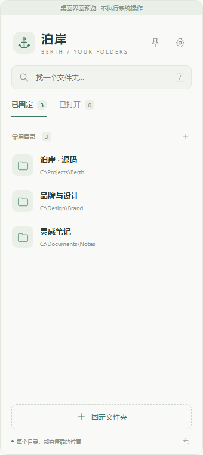
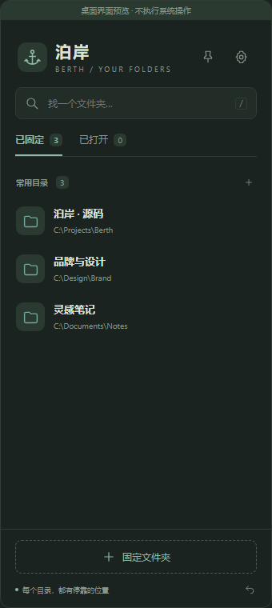

# Berth

A quiet harbor for your folders. Pin folders to an edge panel; click to focus an existing Explorer/Finder window or open a new one. Built with Tauri 2, Rust, TypeScript and the system WebView.

[中文](README.md) · [Releases](https://github.com/lvguidong/Berth/releases) · [Changelog](CHANGELOG.md) · [Testing](docs/TESTING.md) · [Implementation status](docs/IMPLEMENTATION.md)

 

[UI walkthrough (WebM)](docs/images/demo.webm). These are labeled browser previews; OS window behavior is covered separately by native integration tests.

## Download — 0.1.0

| Platform | Package | Notes |
| --- | --- | --- |
| macOS 12+ (Apple Silicon / arm64) | `Berth_0.1.0_aarch64.dmg` on the [v0.1.0 release](https://github.com/lvguidong/Berth/releases/tag/v0.1.0) | Built and validated on an Apple Silicon Mac. Unsigned. |
| Windows 10/11 (x64) | Build from source (see below) | Requires WebView2 Runtime; not part of this release. |

Verify the download with the `SHA256SUMS` file attached to the release:

```sh
shasum -a 256 -c SHA256SUMS
```

The app is unsigned and not notarized. On macOS, right-click the app and choose **Open** the first time if Gatekeeper blocks it (System Settings → Privacy & Security → Open Anyway). On first use, allow Berth to control Finder under **System Settings → Privacy & Security → Automation** so existing Finder windows can be discovered and reused.

## Getting started

1. Open the DMG and drag **Berth** into Applications, then launch it. Berth lives in the menu bar / system tray (`LSUIElement`, no Dock icon).
2. The panel docks to a screen edge and collapses to a thin strip when the pointer leaves. Move the pointer to that edge to expand it, left-click the tray icon, or press `Ctrl+Alt+Space`. Click the pin button at the top to keep it open.
3. Drag a folder into the panel, or click **Pin folder** and enter or browse for a path.
4. Click a pin to switch to an existing window; Shift+click or middle-click forces a new one. A dot means the folder is open; a number means several windows are open.

The interface supports **English and Simplified Chinese**. Open Settings → **Language** to switch; the choice is saved in `config.json` and also applies to the native tray menu. With multiple displays, Settings → **Display** lets you pin the panel to one screen instead of following the mouse.

On Windows, run the NSIS installer or unzip the portable build and run `berth.exe`.

## What's in 0.1.0

- Pin folders only: drag and drop, manual entry, system picker, aliases, colors, groups and drag-to-reorder.
- Stale-path warnings with relocation, and undo for the last 50 organization changes (per session).
- Window list, open/minimized state, restore, duplicate-window merging with confirmation.
- Edge sidebar, floating window and hotkey popup modes; monitor selection, workspace constraints, saved floating position.
- Search, configurable global hotkeys, pin the foreground Explorer/Finder folder, direct access to the first nine pins.
- Tray menu, opt-in launch at login, single instance, bounded crash recovery.
- Atomic JSON config writes, corrupt-config backups, import/export, system light/dark theme.
- Bilingual UI (English / 简体中文) with a language setting in `config.json`.

Default shortcuts: `Ctrl+Alt+Space` toggles Berth, `Ctrl+Alt+P` pins the foreground folder. Optional `Ctrl+Alt+1–9` opens the first nine pins. `/` focuses search; `Ctrl/Cmd+Z` undoes an organization change outside input fields.

## Memory behavior

On Windows, Berth releases its WebView five seconds after the panel collapses or hides, keeping only the native edge and the Rust backend. Waking the UI reloads the WebView (about one second in an idle local test, longer under load). A pinned-open panel keeps the WebView and uses more memory.

On macOS the WebView is **not** released: WKWebView child views cannot be reliably re-attached after being closed, which produced a blank panel on wake. macOS builds therefore keep the WebView alive; idle memory is higher than the Windows figure. The 50 MiB resident-memory requirement is a target, not a blanket claim, and must include WebView helper processes.

## Development

Node.js 22.12+, Rust 1.90+ and platform prerequisites (Windows C++ Build Tools/SDK/WebView2, or macOS Xcode Command Line Tools):

```sh
npm ci
npm run desktop
```

`npm run dev` is an explicitly labeled browser preview and never operates OS windows.

```sh
npm run build
npm test
npx playwright install chromium
npm run test:e2e
cargo test --manifest-path src-tauri/Cargo.toml
cargo clippy --manifest-path src-tauri/Cargo.toml -- -D warnings
npm run bundle -- --bundles nsis
```

On macOS, build the `.app` with `npm run bundle -- --bundles app`. Tauri's bundled `bundle_dmg.sh` fails on some macOS versions while parsing the temporary disk device, so the DMG for this release is created with `hdiutil create -format UDZO` from a staging folder instead.

Releases are published from locally built and verified packages. The packaging workflow in `.github/workflows/release.yml` runs on **manual dispatch only** so a version tag does not create a competing CI draft release.

## Privacy and persistence

No network access, accounts, telemetry or automatic update client. The application never changes the contents of pinned folders. Configuration is stored atomically as local JSON:

- Windows: `%APPDATA%\Berth\config.json`
- macOS: `~/Library/Application Support/Berth/config.json`

Corrupted configuration is preserved under a unique backup name. Import replaces configuration, including startup/shortcut settings and the language choice, and can be undone. Use `BERTH_CONFIG_DIR` for isolated test profiles. Build dependencies and the install-time WebView2 download require network access; the app itself does not.

## Limitations

Windows 11 tabs are not yet reliably selected: ambiguous multi-tab windows produce guidance instead of claiming success and are never auto-merged. Cross-virtual-desktop activation depends on system policy. Network-path checks time out with bounded workers. Without macOS Automation permission, opening folders remains available but discovery/reuse and guaranteed force-new are unavailable. Workspaces, recent folders and terminal/VS Code actions are not part of this release.

The 10 MB installer, 50 MB resident memory, sub-300 ms switching and 24-hour/7-day stability requirements are targets, not blanket claims. Version 0.1.0 is an unsigned preview build; only the macOS arm64 package has been validated on real hardware so far.

Licensed under the [MIT License](LICENSE).
